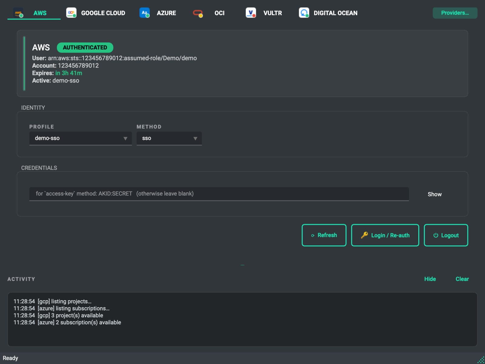
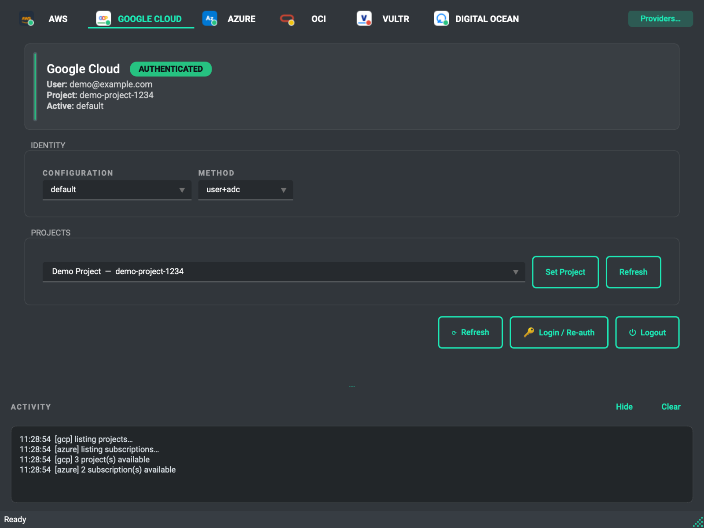
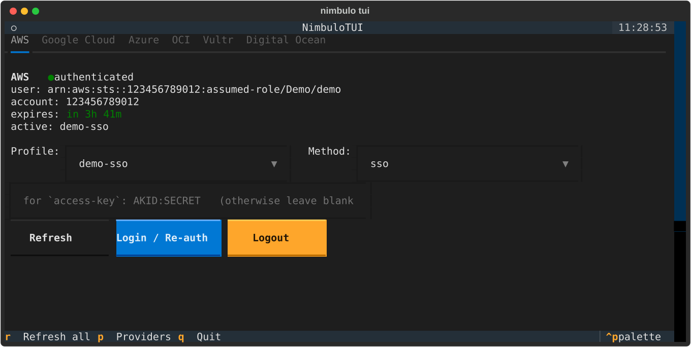
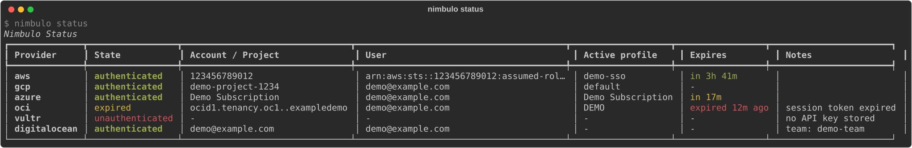

# nimbulo

One place to see "am I logged in?" across AWS, GCP, Azure, Oracle Cloud (OCI), Vultr, and Digital Ocean — and to re-auth without remembering each tool's commands.

The underlying CLIs (`aws`, `gcloud`, `az`, `doctl`/`vultr-cli`) remain the source of truth. This app wraps them: status checks, login flows (SSO browser, ADC, device code, API key), profile/configuration/subscription/project switching, and surfaces SSO token expiration.

## Surfaces

The same provider layer drives four interchangeable UIs:

| Command                | UI       | Use case                                                     |
| ---------------------- | -------- | ------------------------------------------------------------ |
| `nimbulo`          | GUI      | PySide6 desktop window with tabs per provider (default).     |
| `nimbulo tui`      | TUI      | Textual terminal UI with the same tabs.                      |
| `nimbulo menubar`  | menubar  | Resident tray icon (macOS menu bar / Linux system tray) with aggregate health + per-provider menu. |
| `nimbulo status`   | CLI      | Status table for all providers (or one with `-p aws`).       |

Every action in the GUI/TUI/menubar is also a CLI subcommand. Run `nimbulo --help` to see all.

## Screenshots

**GUI** (PySide6): per-provider tabs with live status, profile/method pickers and an activity log.





**TUI** (`nimbulo tui`):



**CLI** (`nimbulo status`):



Screenshots use fake demo data and are regenerated with `uv run python scripts/make_screenshots.py`.

## Install

Requires Python 3.12+ and [uv](https://docs.astral.sh/uv/). Tested on Python 3.12 and 3.13 (on Python 3.15, PySide6 6.12 breaks Textual's worker threads when the GUI and TUI run in one process).

```bash
# Install globally so `nimbulo` is on PATH everywhere
uv tool install nimbulo
# or
pipx install nimbulo
```

To upgrade: `uv tool upgrade nimbulo` (or `pipx upgrade nimbulo`).

To uninstall: `uv tool uninstall nimbulo`.

## Providers

| Provider     | Backed by           | Profile concept   | Secondary picker | Credentials                                |
| ------------ | ------------------- | ----------------- | ---------------- | ------------------------------------------ |
| AWS          | `aws` CLI           | Profile           | —                | SSO browser, or AKID/secret to `~/.aws/credentials` |
| Google Cloud | `gcloud` CLI        | Configuration     | Project          | `gcloud auth login` (+ ADC), service accounts via gcloud |
| Azure        | `az` CLI            | —                 | Subscription     | `az login` (browser or `--use-device-code`) |
| OCI          | `oci` CLI           | Profile (in `~/.oci/config`) | Compartment | Session browser auth, API key (generated or existing), or an existing profile |
| Vultr        | api.vultr.com       | —                 | —                | API key — env, `~/.vultr-cli.yaml`, or macOS Keychain |
| DigitalOcean | api.digitalocean.com| —                 | —                | API token — env, `~/.config/doctl/config.yaml`, or macOS Keychain |

For Vultr/DO the API key **is** the credential. `Logout` is a no-op informational message; use **Forget Key** (or `nimbulo forget vultr`/`digitalocean`) to actually remove the stored key from Keychain.

## Common CLI subcommands

```bash
nimbulo status                       # all providers
nimbulo status -p aws --profile foo  # one provider, specific profile

nimbulo login aws -m sso --profile my-profile
nimbulo login aws -m access-key --profile foo --region us-east-1
nimbulo login gcp                    # default method is user+adc (two browsers)
nimbulo login gcp -m adc
nimbulo login azure                  # `az login`
nimbulo login azure -m device-code   # headless / SSH

nimbulo profiles aws
nimbulo projects                     # GCP
nimbulo subscriptions                # Azure
nimbulo compartments                 # OCI
nimbulo set-project <project-id>     # GCP
nimbulo set-subscription <sub-id>    # Azure
nimbulo set-compartment <ocid>       # OCI

nimbulo providers                    # list providers and whether each is enabled
nimbulo providers disable oci        # hide a provider (also: enable <key>)

nimbulo logout aws                   # `aws sso logout`
nimbulo forget vultr                 # delete keyring entry
```

## OCI

Three login methods:

```bash
# Browser session (token-based, expires; refresh by logging in again)
nimbulo login oci -m session --profile my-profile --region us-ashburn-1

# Use a profile that already exists in ~/.oci/config (it becomes the active profile)
nimbulo login oci -m profile --profile my-profile

# API key: generate a new key pair (or pass --key-file <path> for an existing one)
nimbulo login oci -m api-key --profile my-profile --user <user-ocid> \
  --tenancy <tenancy-ocid> --region us-ashburn-1 --generate-key
```

Missing api-key fields are prompted for; there is no secret to type. Use `--overwrite` to replace an existing profile.

**Session login on an API-key profile.** `oci session authenticate` converts the profile to a session profile (removing its key entries) and rewrites `~/.oci/config` without comments, so nimbulo refuses unless you confirm (GUI/TUI) or pass `--overwrite` (CLI). Use a new profile name to keep the API-key profile.

**Logout removes the profile.** `oci session terminate` deletes the session profile from `~/.oci/config`, so `nimbulo logout oci` asks first (`--yes` skips the prompt); log in with the session method and the same name to recreate it. API-key profiles cannot be logged out.

**Console upload required.** After API-key login the public key is printed; you must upload it in the OCI console (Identity -> Users -> your user -> API keys -> Add API key) before the profile can authenticate.

Compartments:

```bash
nimbulo compartments                 # id and path for the active profile
nimbulo set-compartment <ocid>       # add --profile <name> to either for another profile
```

If `OCI_CLI_CONFIG_FILE` is set, nimbulo reads and writes that file instead of `~/.oci/config`, exactly as the `oci` CLI does.

**Passphrase-protected keys.** The API-key form only accepts unencrypted keys. An existing profile with an encrypted key needs a `pass_phrase` entry in its config (the `oci` CLI reads it from there); without one, nimbulo reports the problem instead of letting `oci` prompt. The session method avoids keys entirely.

Nothing is stored in `~/.oci/config` except standard profile entries; the compartment choice lives in `~/.config/nimbulo/settings.json`.

## Enabling and disabling providers

If you only use some of the clouds, hide the rest. Disabled providers disappear from the GUI tabs, the TUI tabs, the menu bar, the tray summary, and `nimbulo status`. The choice is stored in `~/.config/nimbulo/settings.json`:

```json
{
  "providers": { "disabled": ["vultr", "digitalocean"] }
}
```

Ways to change it (all write the same setting):

- CLI: `nimbulo providers` lists every provider with its state; `nimbulo providers disable <key>` / `nimbulo providers enable <key>` change it. Keys: `aws`, `gcp`, `azure`, `oci`, `vultr`, `digitalocean`.
- GUI: the **Providers…** button.
- TUI: press `p`.
- Menu bar: the **Providers** submenu (checkable entries). A running menu bar re-reads the setting each time you open its menu and every 2 minutes, and updates the GUI window it hosts. A standalone GUI or TUI re-syncs its tabs only when you save its own Providers dialog; otherwise restart it to pick up changes made elsewhere.

At least one provider must stay enabled; if the file disables all of them, all are shown. Disabling only hides a provider: nothing is deleted, no credentials or CLI config are touched, and explicit commands such as `nimbulo login oci` still work for a disabled provider.

## Auto-start the menu bar at login (macOS and Linux)

```bash
nimbulo autostart install      # register the menu bar to start at login (and start it now)
nimbulo autostart status       # check whether it's installed (and loaded / running)
nimbulo autostart uninstall    # remove it and stop the running menu bar
```

**macOS:** writes `~/Library/LaunchAgents/com.nimbulo.menubar.plist` and `launchctl load`s it. The agent runs `nimbulo menubar`; it starts automatically on next login, and logs go to `~/Library/Logs/nimbulo/menubar.{log,err}` (a private, owner-only directory). Re-run `nimbulo autostart install` to move an existing install off the old `/tmp` log paths.

**Linux:** writes an XDG autostart entry, `${XDG_CONFIG_HOME:-~/.config}/autostart/nimbulo-menubar.desktop`, honored by GNOME, KDE, XFCE and most other desktops (no systemd needed). Install also starts the menu bar immediately when a graphical session is detected (`DISPLAY` or `WAYLAND_DISPLAY`); otherwise it starts at next login. A desktop entry cannot redirect output, so menu bar output goes to the desktop session journal (`journalctl --user`). On GNOME the tray icon needs the AppIndicator/StatusNotifier shell extension. `status` reports the entry and whether a `nimbulo menubar` process is running (via `pgrep`). Linux support is not yet tested on real desktops.

## Where things live

| Path                                       | What                                             |
| ------------------------------------------ | ------------------------------------------------ |
| `~/.aws/config`, `~/.aws/credentials`      | AWS profiles (managed by `aws` CLI)              |
| `~/.aws/sso/cache/*.json`                  | SSO tokens; expiry is read from here             |
| `~/.config/gcloud/`                        | gcloud configurations + ADC                      |
| `~/.azure/`                                | Azure CLI session                                |
| `~/.oci/config`, `~/.oci/sessions/`, `~/.oci/keys/` | OCI profiles, session tokens, generated API keys |
| `~/.vultr-cli.yaml`                        | Vultr CLI config (optional)                      |
| `~/.config/doctl/config.yaml`              | doctl config (optional)                          |
| macOS Keychain, service `nimbulo`      | Stored Vultr/DO API keys                         |
| `~/Library/LaunchAgents/com.nimbulo.menubar.plist` (macOS), `${XDG_CONFIG_HOME:-~/.config}/autostart/nimbulo-menubar.desktop` (Linux) | Menu bar autostart entry (`nimbulo autostart`) |
| `~/.config/nimbulo/settings.json`      | App preferences (window geometry, last-selected profile per provider, disabled providers, etc.) |

Nothing is read or written outside these. The app never bypasses the underlying CLIs for credential material.

## Project layout

```
src/nimbulo/
├── __init__.py            # main() entry point
├── models.py              # ProviderStatus, Identity, format_expires
├── settings.py            # JSON-backed persistent preferences
├── secrets.py             # macOS Keychain wrapper for Vultr/DO
├── assets/                # bundled provider logo SVGs
├── providers/
│   ├── base.py            # abstract Provider + subprocess helpers
│   ├── aws.py             # `aws` CLI + SSO cache parsing for expiry
│   ├── gcp.py             # `gcloud` CLI + project list
│   ├── azure.py           # `az` CLI + subscription list
│   ├── oci.py             # `oci` CLI + compartments (oci_config.py reads/writes ~/.oci/config)
│   ├── vultr.py           # HTTP to api.vultr.com + keyring
│   └── digitalocean.py    # HTTP to api.digitalocean.com + keyring
└── ui/
    ├── cli.py             # Typer commands (entry point routes here)
    ├── tui.py             # Textual TUI
    ├── gui.py             # PySide6 GUI (default)
    └── menubar.py         # macOS menu-bar status app
```

Adding a sixth provider means writing one file in `providers/` and adding it to `providers/__init__.py:all_providers()`. The UI shape is data-driven via `profile_label` and `secondary_label` attributes on the Provider — no UI changes needed for typical providers.

## Building a wheel

```bash
uv build                              # produces dist/nimbulo-<version>-py3-none-any.whl + .tar.gz
```
